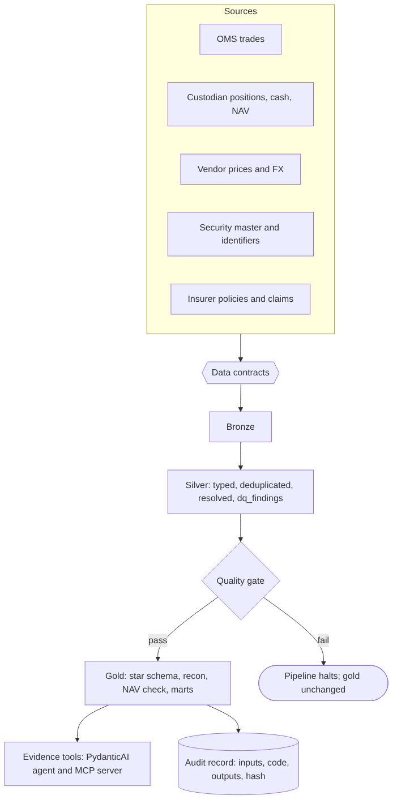

# fundlake

A governed data platform for a **simulated asset manager with an insurance book**, built to show data engineering, data modelling, controls and an evidence-grounded AI workflow on financial-services data.

> **All data is synthetic.** Funds, securities, private funds, brokers, policies and clients are invented. Identifiers carry valid ISIN/SEDOL/CUSIP check digits but are not issued and may coincide with real ones only by chance. Every fault is planted by `src/fundlake/synth.py` and recorded in `data/raw/answer_key.json`, so detection is **scored**, not just demonstrated. No real firm, fund or person is described.

## What it does

Six fragmented sources (order-management system, custodian, market-data vendor, security master, insurer extract, and private-markets GP notices and capital-account statements) land as CSV, are checked against 17 data contracts, and are built by dbt into bronze, silver and gold layers (64 models, 69 data tests, 3 unit tests). A quality gate between silver and gold stops the run if thresholds are breached. Gold holds a star schema for listed holdings (36 listed equities and 24 corporate bonds), a custodian-to-OMS reconciliation, a NAV control against the administrator, a private-markets mart (8 private funds: buyout, growth, real estate, infrastructure, secondaries; one interest bought on the secondary market), an insurance claims mart, a GDPR-minimised client view and an illustrative Solvency II-style asset listing. A PydanticAI agent and an MCP server answer control questions from six evidence tools and abstain when the data cannot support an answer.



## Run it

```bash
pip install -e ".[agent,snowflake,dev]"
make all          # generate data, run the pipeline, score the controls, evaluate the agent, build the PDF notes
make test         # pytest: pipeline, controls, private markets, agent, Snowflake render, Airflow records
```

`python -m fundlake.pipeline` runs contracts, dbt silver, the gate, dbt gold and the audit record on DuckDB in under a minute.

## What has and has not been run

| Component | Status |
|---|---|
| Generator, contracts, dbt on **DuckDB**, gate, audit trail, controls, private markets, lineage, privacy | **Run and tested** (pytest) |
| **Airflow** | **Run**: `scripts/run_airflow_dag.sh` runs the DAG with `airflow dags test` on Airflow 3.1.8: all five tasks succeed and the build id and gold hash equal the local runner's; on a corrupted identifier file the gate task fails and gold and audit are skipped (`upstream_failed`). Both runs recorded in `outputs/`. |
| **PySpark** bronze ingestion | **Run locally** on Spark 3.5.6: all 17 bronze tables identical to DuckDB's (row counts, row numbering, SHA-256 of every row). On Databricks: `scripts/run_databricks.sh` (asset bundle, serverless, Free Edition) is written and **not yet run**. |
| **Snowflake** | Every model renders for the snowflake target and parses as Snowflake SQL (tested). `scripts/run_snowflake.py` (key-pair service user; PUT and COPY INTO; dbt; the gate; row access and masking policies checked role by role; fault scoring; every gold table compared with DuckDB) is written and tested offline, **not yet run on a Snowflake account**. |
| Agent and MCP server | Tools, schema, MCP, faithfulness checker and evaluation harness **run** with a **scripted model that is not an LLM**. **No real LLM run yet**; `scripts/run_agent_live.py <model>` does it with an API key. |

## Results (reference build `77a376fd6d15dd56`)

- **Detection against the answer key: 156 of 156 planted faults found, 0 false positives**, across 19 fault classes. Caveat: the rules were written knowing these classes; this says the controls work as designed, nothing about fault types that were not planted.
- **NAV control:** 35 of 256 fund-days differ from the administrator by more than 0.5 bp (max 51.2 bp, £108,608); every one is explained by a flagged carried price, stale price or stale FX day; clean days agree to under £1.
- **Position breaks:** 71 break-days in 5 episodes; 3 are one unbooked trade each, 1 a position missing at the custodian, 1 unexplained (and reported as such).
- **As-of identifiers:** a join on the current ISIN would drop 90 custodian rows for the one security that changed ISIN; the as-of join drops none. 32 of 769 OMS rows are replayed copies, removed before positions are built.
- **Private markets:** paid-in, distributions, NAV, DPI, RVPI, TVPI and IRR for 10 commitments match an independent Python calculation (IRR by a pure-SQL grid search, within 1e-6 of Python XIRR). The secondary interest shows TVPI 1.55x on its purchase price against 1.34x on the GP-reported basis. Reconciling GP capital-account statements to our notices finds a missing capital call (£808,263.77 from Q3 2025), so that commitment is marked unreconciled. Statements arrive 92 days stale; rolling NAV forward with later cashflows still leaves an average 3.4% gap (up to 6.4%) to the true NAV, which is reported, not hidden.
- **Reproducible:** two builds from the same inputs, and the Airflow run, give the same build id and gold hash.
- **Agent evaluation (scripted model):** 30 questions: 24 answerable at 100% accuracy, 6 unanswerable with 100% abstention, 0 hallucinated numbers; two deliberately faulty variants are caught.

## Layout

```
src/fundlake/      synth, synth_pm (private markets), contracts, pipeline, detection, lineage, privacy; agent/ (tools, agent, mcp_server, eval)
dbt/               models (bronze, silver, gold), macros/dialect.sql (eight adapter-dispatched macros), tests, unit tests
contracts/         17 data contracts, gate.yaml thresholds, access.yaml roles
airflow/dags/      fundlake_daily (validate -> silver -> gate -> gold -> audit); scripts/run_airflow_dag.sh runs it
spark/             PySpark bronze ingestion; databricks.yml + scripts/run_databricks.sh run it on Databricks
snowflake/         reference SQL; scripts/run_snowflake.py runs the whole build on Snowflake and compares it with DuckDB
docs/              MODEL.md, DATA_DICTIONARY.md (generated), columns.yaml, sources of the two PDF notes
outputs/           results.json, agent_eval.json, recorded Airflow and Spark runs, the two PDF notes
```

## Run on Snowflake and Databricks (your accounts)

1. Snowflake 30-day trial, **Enterprise** edition (row access policies need it), any UK/EU region. Then `python scripts/run_snowflake.py keygen`, paste the printed SQL into a Snowsight worksheet, run it as ACCOUNTADMIN, and `python scripts/run_snowflake.py run --account <orgname-accountname>`. Result: `outputs/snowflake_run.json`.
2. Databricks Free Edition. Then `databricks auth login --host <workspace URL>` and `bash scripts/run_databricks.sh`. Result: `outputs/databricks_run.json`.

## Design decisions

- **Dialect isolation.** Eight macros in `dbt/macros/dialect.sql` (bronze read, carry-forward, calendar spine, integer series, string aggregation, day and year differences, month truncation) hold all warehouse-specific SQL; the rest is ANSI, with joins instead of correlated subqueries so Snowflake accepts it.
- **Private markets the way an LP sees them.** Notice amounts come from their line items; resent notices are dropped; a secondary interest is measured on its purchase price, with the GP's inherited figures alongside; the lagged statement NAV is rolled forward and labelled an estimate; every GP capital account is reconciled to our notices.
- **Detection and prevention are separate.** `dq_findings` reports; the gate decides by rate. Unresolved identifiers warn in dbt and block at the gate, so tolerance lives in one place.
- **Missing data is filled visibly**, never silently: carried prices and rates are flagged and counted in every NAV row.
- **Personal data split at silver**; gold has a salted key, age band and postcode district. Row-level security is enforced in Python on DuckDB (`privacy.py`) and in DDL for Snowflake (`rls.sql`); the two are kept in step by hand.
- **Lineage by construction**: every row carries `file:row`, and `fundlake.lineage` re-reads the raw row to prove it.

## Limitations

Single GBP base currency; bonds without accrued interest; no subscriptions or redemptions; earned premium pro rata; the Solvency II-style listing is illustrative, not an EIOPA template; the NAV decomposition is exact by construction but is not a performance-attribution system. Synthetic data cannot show how the controls behave on the messiness of real feeds.
