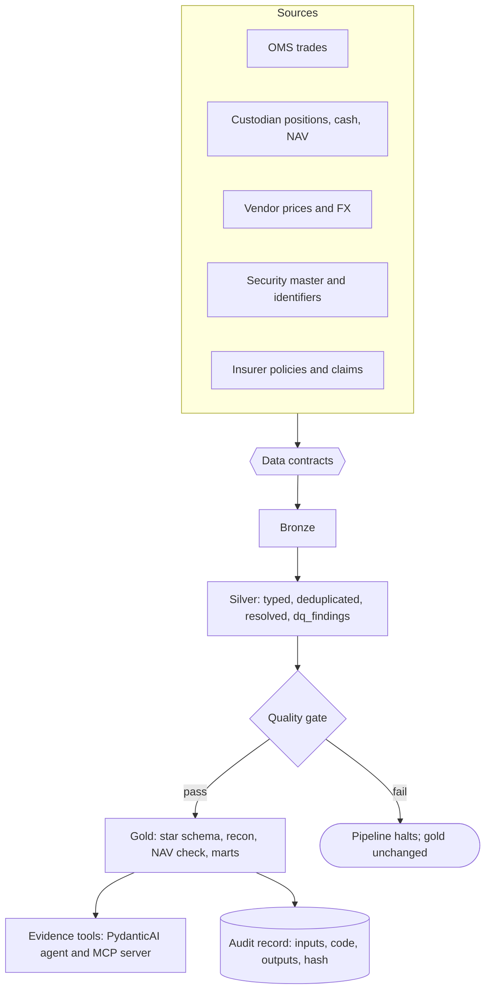
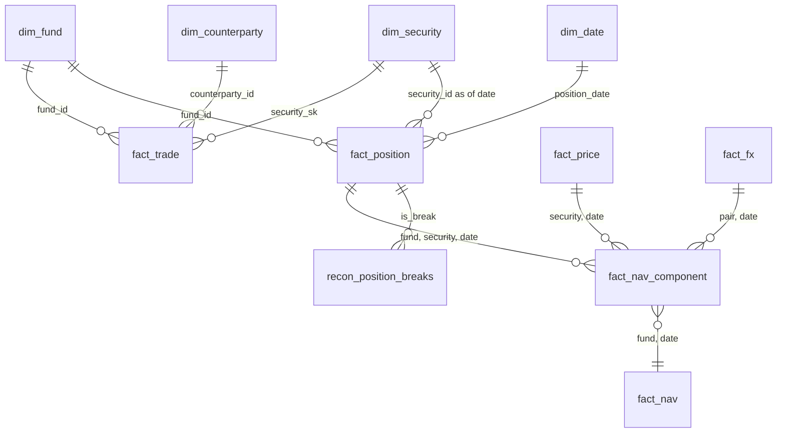
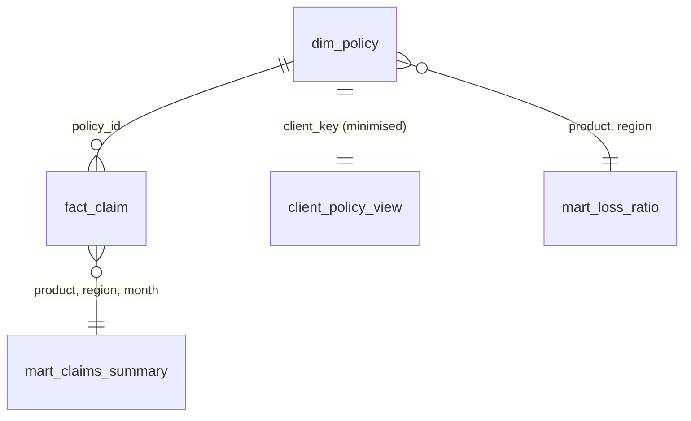

# Data model

All data is synthetic. Layers: **bronze** (landed, all-varchar, with `_source_file` and `_row_number`), **silver** (typed, deduplicated, identifiers resolved, findings), **gold** (star schema, controls, marts).

## Flow

## Star schema: holdings and performance

## Insurance mart

## Design decisions

- **Type 2 on the security master.** `dim_security` keeps one row per attribute version (`valid_from`, `valid_to` inclusive). Facts join as of the event date, so a bond downgraded on 20 August is valued and listed with the rating in force on the date being reported.
- **Identifiers are effective-dated and have an owner.** The cross-reference maps SEDOL (OMS), ISIN (custodian, vendor) and CUSIP to `security_id` with validity dates. If two securities claim one identifier, the earliest claim owns it and the later one is ignored and reported (`identifier_conflict`).
- **Missing data is filled visibly.** A missing vendor price or FX rate is carried forward and flagged (`is_carried`); a price unchanged for four or more days is flagged stale. NAV rows count both.
- **Detection and prevention are separate.** `dq_findings` reports; the gate (`contracts/gate.yaml`) decides, by rate, whether the run may continue.
- **Personal data is split at silver.** `silver_clients` holds names, e-mails, dates of birth and postcodes; gold carries a salted pseudonymous key, an age band and a postcode district only.
- **Lineage is by construction.** Every silver and gold row carries `src_row_id` (`file:row`) or a list of them; `fundlake.lineage` re-reads the raw row to prove it.

## Simplifications (deliberate)

All funds are GBP-based; bonds are quoted per 100 par without accrued interest; there are no external subscriptions or redemptions, so returns are NAV changes; the Solvency II-style listing is illustrative and not an EIOPA template; earned premium is pro rata days in force.
